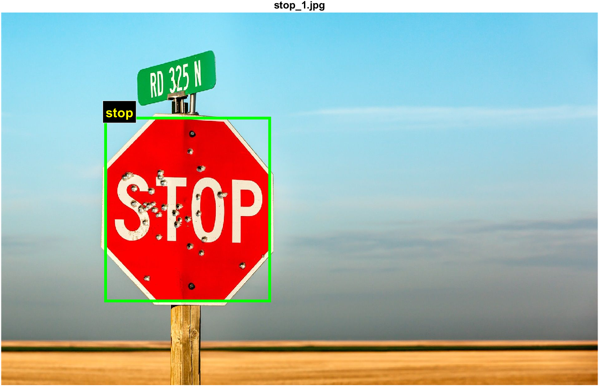
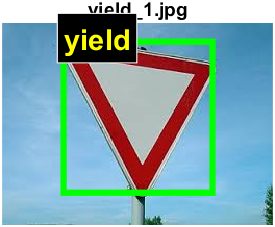
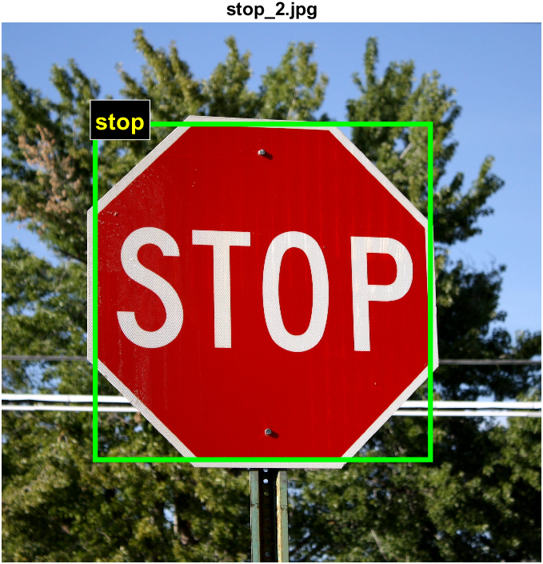

# Traffic Sign Recognition (MATLAB)

Detects a red traffic sign in a photo and recognizes its type (stop, yield, no entry, ...).
[فارسی](README.fa.md)

## How it works

1. **Segmentation** – the image is converted to HSV and thresholded for red (hue wraps around 0/1, so two ranges are combined). Minimum saturation and value keep gray/dark pixels out. The mask is then cleaned with opening, hole filling and small-blob removal.
2. **Localization** – the largest red region is taken as the sign and cropped by its bounding box.
3. **Recognition**
   - *Shape check:* the ratio of region area to bounding-box area (`Extent`) separates triangles (~0.5) from circles (~0.79) and octagons (~0.83). The yield sign is almost textureless, so it is identified by its triangular shape.
   - *SURF matching:* for the other signs, SURF features of the crop are matched against every reference image. Matches are filtered with a geometric (similarity) transform fitted by RANSAC, and the reference with the most inliers wins. If the best score is below a threshold (`minInliers`, default 6) the result is `Unknown`.

Reference features are computed once, not on every call.

## Project structure

```
.
├── src/
│   ├── main.m                  % entry point
│   ├── createMask.m            % HSV red mask + cleanup
│   ├── findSign.m              % largest red region, bounding box, shape
│   ├── buildReferenceDB.m      % SURF features of the reference signs
│   ├── recognizeSign.m         % shape check + SURF matching
│   ├── extractSignFeatures.m
│   └── loadSignImage.m
├── data/
│   ├── reference/              % one image per sign, file name = label
│   └── test/                   % test photos
└── results/                    % output images written by main.m
```

## Requirements

- MATLAB with **Image Processing Toolbox** and **Computer Vision Toolbox**
- `estimateGeometricTransform2D` (R2022b+) is used when available; older releases fall back to `estimateGeometricTransform`.

## Usage

Open the project folder in MATLAB and run `src/main.m`. It loads the reference signs from `data/reference`, processes every image in `data/test`, prints the result and saves an annotated image to `results/`.

To add a new sign, put one clean image of it in `data/reference/` and name the file after the label (e.g. `speed_limit.png`). To test your own photo, drop it into `data/test/`.

## Results

| `stop_1.jpg` | `yield_1.jpg` | `stop_2.jpg` |
|---|---|---|
|  |  |  |

## Limitations

- Only red signs are found; blue and yellow signs are not handled.
- The largest red region is assumed to be the sign, so a large red object (a car, a wall) can fool it.
- Only five reference signs, one image each. Feature matching compares clean icons with real photos, which is fragile under strong perspective, blur or low resolution.
- The shape rule recognizes triangles as "yield" only because there is a single triangular reference.

## Possible improvements

- Train a classifier (HOG + SVM or a small CNN) on a dataset such as GTSRB instead of matching against single reference images.
- Detect multiple signs per image.
- Add blue/yellow color ranges and a proper shape classifier.

## Notes

The reference and test images are used for educational purposes only.
